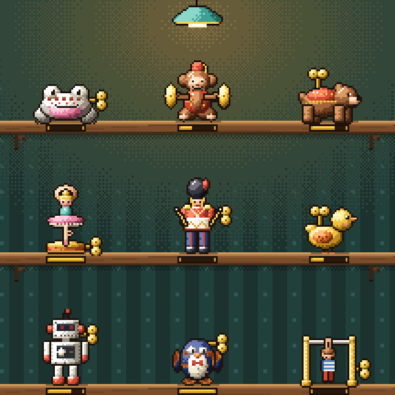

<div align="center">


# Windup

### A little movement, all day long — like winding tin toys.

*We were taught that exercise is an hour a couple of times a week. The body prefers a little, all day long: squats while the kettle boils, a one-leg stand while brushing your teeth, the stairs instead of the lift. Windup is a shelf of nine pixel-art tin toys; a winding lasts two hours, so the key wants turning often — a minute or three at a time. Free, no ads, no account, no internet.*

[](https://github.com/bigdevwhale/windup/actions/workflows/android.yml)


[](LICENSE)

**English** · [Русский](README.ru.md) · [Changelog](CHANGELOG.md)



</div>

---

## How it works

1. **Nine toys, nine kinds of movement.** The frog squats and jumps, the monkey pushes, the bear holds the core and crawls, the ballerina balances, the drummer keeps posture and walks, the bird hinges, the robot turns, the penguin works the feet — and the acrobat, built from a blueprint, pulls.
2. **Where are you?** At the desk, by the kettle, in a queue, brushing teeth, on a call, outside or with kit: the shelf suggests three movements that fit, the stopped and rusty toys first. 58 movements, most with no equipment at all; the rest use a kettlebell, dumbbells, a band, a bar, a rope or a backpack.
3. **Every rep is a click of the key.** Tap, or let a hold tick by itself; squats, jumps and marching can be counted by the phone in a pocket. Ladders make a movement harder step by step and climb by themselves when a set runs long.
4. **A pin in the drum.** Each set hammers a pin into today's music-box drum. Pins spread across the day pay extra gears and springs; a third winding inside half an hour overwinds the spring and pays nothing.
5. **The day plays as a tune.** In the music box any day plays back, an hour a second, each toy a note; the toys wound that day march across the table. An even day is a melody, a crammed evening is one chord.
6. **Workshop.** Gears and springs build the acrobat and buy paint jobs; capsules come daily and with every third pin; toys left alone for days slowly rust.
7. **One quiet reminder.** When the toys stand still for a while in your waking hours, one notification asks for the key. Unanswered, they space out, and after three it's quiet till morning.

## Build

```
./gradlew testDebugUnitTest assembleDebug
./gradlew -Pdemo assembleDebug          # app.windup.demo with four weeks of windings
./gradlew testDebugUnitTest -Prender --tests '*RenderArt*'   # toys and scenes to app/build/art
```

All art is drawn in code (`ui/art`): shaded tin parts with dithering and auto outlines, a 48×48 frame per toy. Sounds are synthesised on first launch.

Font: [m6x11](https://managore.itch.io/m6x11) by Daniel Linssen.
